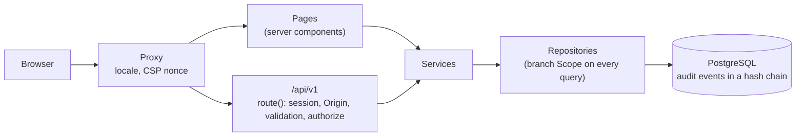

# ShipLens

One trusted place for a volunteer organisation with branches in many cities: a bilingual
public website (English and Urdu) and a private platform where branches log collections and
weekly reports, HR manages volunteers, and head office sees approved numbers it can trace
all the way down to the audit trail.

[](https://github.com/Abdullah2240/ShipLens-1.0/actions/workflows/ci.yml)

Built for the ShipLens 1.0 challenge (EchoLens).

## Live demo

- **URL:** OWNER-CONFIRM: live Render URL
- **Test logins:** one per role, listed in [docs/test-logins.md](docs/test-logins.md). The
  password is shared with judges through the submission form and is never in the repository.

## What it does

- **Public site** in English and Urdu (right to left): Home, About, Programs, Branches,
  Events, Get Involved with a validated volunteer application form, Contact, an impact page
  with approved totals, and a public check for approved weekly reports.
- **Private platform**: branch register with generated codes and a status lifecycle,
  volunteer applications and members with teams, offline collections that lock after 7
  days, weekly reports that go draft, submit, return or approve, a head office dashboard
  with drill-down from every figure to its audit events, CSV and print exports, WhatsApp
  sharing of weekly reports, a content manager with draft and publish, and an audit trail
  of every change written in the same transaction as the change, with an audit viewer that
  shows whether the trail is intact.

| Role             | What they can do                                                                             |
| ---------------- | -------------------------------------------------------------------------------------------- |
| Super Admin      | Everything, across all branches: branches, audit log, dashboard                              |
| Finance Reviewer | Approve or return weekly reports, dashboard and drill-down, mark collections sent to main    |
| Content Editor   | Edit, preview and publish the public site content                                            |
| Branch Lead      | Own branch only: log and correct collections, submit the weekly report, share it on WhatsApp |
| HR Lead          | Own branch only: review volunteer applications, manage members and teams                     |

The full role-by-action table is generated from code: [docs/permissions.md](docs/permissions.md).

## Proof, not promises

Donors should not have to take our word that an approved number is real, so every audit
event is chained to the one before it with a SHA-256 hash, and any edit, insertion or removal
breaks the chain where it happened. Admins see the chain status in the audit viewer, and a
re-check walks the whole chain. Every approved weekly report gets a short public
verification code and a QR code that also carries a seal taken from its approval event. Anyone
can open the public check page, enter the code and see the report's approved totals and
whether the record still matches its seal. The limits are written down plainly in
[docs/verification.md](docs/verification.md).

## Architecture

One Next.js app (pages and the `/api/v1` route handlers) with PostgreSQL, shipped as one
Docker image.



- Every mutation runs through one command wrapper that checks the permission table and
  writes the audit event in the same transaction.
- Money is stored as exact decimals; dates are stored in UTC and shown as Pakistan business
  dates.
- Decisions and their reasons: [docs/adr/](docs/adr/README.md).

## Run locally

You need Node 24 (see `.nvmrc`) and Docker.

```sh
docker compose up -d --wait db          # Postgres 16 on localhost:5434
cp .env.example .env.local              # then set SEED_ON_BOOT=true and a SEED_DEMO_PASSWORD (12+ characters)
npm ci
node --env-file=.env.local scripts/migrate.mjs   # migrations, then the demo seed
npm run dev                             # http://localhost:3000
```

`npm run migrate` is the same step when `DATABASE_URL` is already in your environment. How
the seed works and what it creates: [db/seed/README.md](db/seed/README.md).

## Tests

```sh
npm test                    # unit tests
npm run test:integration    # integration tests against Postgres (TEST_DATABASE_URL, default localhost:5434/shiplens_test)
npm run test:coverage       # all tests with the coverage thresholds
npm run e2e:docker          # Playwright against the production image; full-suite order in docs/e2e.md
BASE_URL=http://localhost:3100 node scripts/check-headers.mjs   # security headers of a running production build
npm run lint && npm run typecheck
npm run permissions:check && npm run i18n:check   # generated permission table, translation parity
node scripts/gen-api-doc.mjs --check               # docs/api.md matches the route files
node scripts/check-tool-mentions.mjs               # tool names only in AI-USAGE.md
```

CI runs all of these on every push, plus a secret scan of the full git history and a
production dependency audit; the single required check is `ci-ok`.

## Deploy

Render only: one free web service and one free Postgres database from the blueprint in
`render.yaml`. Migrations run on every start, and the app keeps itself warm with a
self-ping. Step by step: [docs/deploy.md](docs/deploy.md) and
[docs/handover.md](docs/handover.md). After a deploy, one command checks health, logins,
headers, the audit chain and a public verification end to end:

```sh
BASE_URL="$URL" SMOKE_DEMO_PASSWORD="$DEMO_PW" node scripts/verify-deploy.mjs --markdown
```

## Docs

| Document                                     | What it covers                                            |
| -------------------------------------------- | --------------------------------------------------------- |
| [docs/adr/](docs/adr/README.md)              | Architecture decision records                             |
| [docs/api.md](docs/api.md)                   | API endpoints, request and response shapes                |
| [docs/permissions.md](docs/permissions.md)   | Role-by-action permission table (generated)               |
| [docs/security.md](docs/security.md)         | OWASP Top 10 mapping with file references                 |
| [docs/verification.md](docs/verification.md) | The audit chain and public report check, and their limits |
| [docs/handover.md](docs/handover.md)         | Running and handing over the live service                 |
| [docs/deploy.md](docs/deploy.md)             | Render deploy runbook                                     |
| [docs/test-logins.md](docs/test-logins.md)   | Demo users, one per role                                  |
| [docs/e2e.md](docs/e2e.md)                   | End-to-end test stack                                     |
| [AI-USAGE.md](AI-USAGE.md)                   | How we used AI tools                                      |

## Data

The organisers' sample data was never received. All demo data in this repository and on the
live site is generated and fictional; no real person's data is used. The generator and its
independently computed expected values live in `db/seed/data` and `db/seed/expected.json`.

## Commit history

OWNER-CONFIRM: organisers' answer about the 25-commits-over-7-days rule (SUB-04), with the
date it was asked.

## Team

| Person                    | Owned                                                                                                                                                                                         |
| ------------------------- | --------------------------------------------------------------------------------------------------------------------------------------------------------------------------------------------- |
| Sheikh Abdullah Bin Zahid | Platform and security kernel, sign-in and permissions, audit trail, branches, collections, weekly reports, head office dashboard and drill-down, exports, Docker and Render deploy, the twist |
| Saniya Hassan             | Public website, volunteer applications, members and teams, content manager, English and Urdu (right to left) across the app, impact page, README and project docs                             |

How the work was done, including the AI tools we used: [AI-USAGE.md](AI-USAGE.md).

## Credits

Built on open-source software: [Next.js](https://nextjs.org), [React](https://react.dev),
[next-intl](https://next-intl.dev), [node-postgres (pg)](https://node-postgres.com),
[PostgreSQL](https://www.postgresql.org), [Zod](https://zod.dev),
[@node-rs/argon2](https://github.com/napi-rs/node-rs), [react-markdown](https://github.com/remarkjs/react-markdown),
[uqr](https://github.com/unjs/uqr), [Tailwind CSS](https://tailwindcss.com),
[Vitest](https://vitest.dev), [Testing Library](https://testing-library.com) and
[Playwright](https://playwright.dev). Fonts: Figtree, Noto Naskh Arabic and Noto Nastaliq
Urdu, under the SIL Open Font License.

## License

MIT. See [LICENSE](LICENSE).
