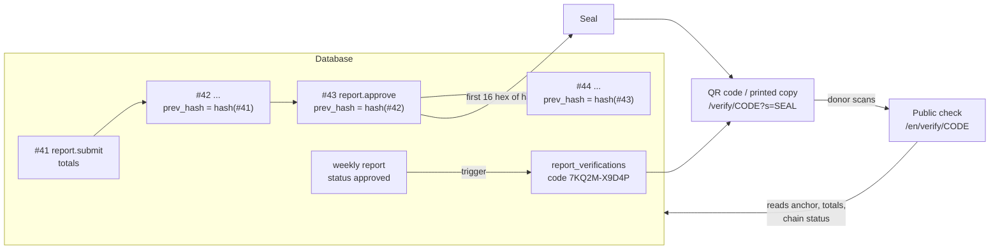

# Proof, not promises: report verification and the audit chain

Donors should not have to take our word that an approved number is real. ShipLens lets
anyone check an approved weekly report for themselves, and lets administrators prove that
the audit trail behind it has not been altered.

This page explains it first in plain words, then technically, then how to check it
yourself, and finally what it cannot do.

Status: the audit chain (database trigger, canonical form) and the verification codes are
built. The chain verifier, the public check page and API, the QR code and the admin badge
are being built to the design below; anything marked **(planned)** describes that agreed
design.

## For donors

**What the code and QR are.** Every weekly report that head office approves gets a short
verification code, printed as two groups of five characters (for example `7KQ2M-X9D4P`),
and a QR code that holds the same code plus a **seal**. You may find them on a printed
report, a shared message or a branch notice.

**How to check.** Scan the QR code, or open the public check page (`/en/verify`, or
`/ur/verify` in Urdu) and type the code. No account is needed. Capital or small letters,
spaces and hyphens do not matter, and the letters O, I and L are read as 0, 1 and 1.

**What you see.** The branch and its city, the report week, the approved total, how many
collections it covers, the date it was approved, and the result of the check.

**What the results mean.**

| Result | Meaning |
| --- | --- |
| Verified | The figures you see are the ones that were submitted and then approved, and the record of that approval is intact. |
| Seal matches | The seal on your copy (from the QR code) matches the approval record held today. |
| Seal does not match | The approval record has changed since your copy was made. Please tell us (see [SECURITY.md](../SECURITY.md)). |
| Figures do not match | The report's figures differ from what was submitted and approved. It should not be trusted until explained. |
| Not anchored | We cannot find the approval record for this report, so its figures cannot be proven. |
| Audit chain broken | Our audit trail has been altered somewhere. No report can be proven until this is resolved. |
| Not recognised | No approved report has this code. Check for typing mistakes; unknown and malformed codes give the same answer. |

**No personal data.** The check never shows anyone's name, email, phone number or
account, and never shows individual collections, notes or reasons a report was returned.
Only the branch-level totals that the organisation would publish anyway.

## How it works

### The audit chain

Every change in ShipLens writes an audit event in the same database transaction as the
change itself. Each audit event is linked to the one before it:

- `chain_seq`: its position, 1, 2, 3, ... with no gaps.
- `prev_hash`: the hash of the event before it (64 zeros for the first event).
- `hash`: the SHA-256 of a fixed text form of the event (canonical form v1), which
  includes `chain_seq` and `prev_hash`.

The database computes these in a `BEFORE INSERT` trigger (`audit_events_chain` in
`db/migrations/202610311400_audit_chain.sql`), so every writer is covered, including the
seed and any manual SQL, and values a writer supplies itself are always overwritten.
Inserts take a short transaction-level advisory lock, so the sequence follows commit
order. A unique index on `chain_seq` turns any attempt to fork the chain into an error.
Separate triggers already reject `UPDATE`, `DELETE` and `TRUNCATE` on `audit_events`.

Canonical form v1 (identical in SQL and in `src/platform/audit/chain/canonical.ts`):

```
'shiplens-audit-v1' || f(chain_seq) || f(prev_hash) || f(id) || f(occurred_at_utc)
  || f(request_id) || f(actor_id) || f(actor_role) || f(action) || f(entity_type)
  || f(entity_id) || f(branch_id) || f(report_id) || f(before::text) || f(after::text)
f(v) = '|' || (v IS NULL ? '-' : byte_length(v) || ':' || v)
occurred_at_utc = 'YYYY-MM-DDTHH:MI:SS.microsecondsZ' in UTC
hash = hex(sha256(utf8(canonical)))
```

The byte-length prefix makes the encoding unambiguous: no value can imitate a separator.
JSON values are hashed as the text Postgres itself produces, never re-serialised.

Changing any stored field of an event changes its recomputed hash (`hash_mismatch`).
Removing or inserting an event leaves a gap in `chain_seq` or a `prev_hash` that no longer
matches (`sequence_gap`, `link_mismatch`). The verifier **(planned)**,
`verifyAuditChain()` in `src/platform/audit/chain/`, walks the chain in order in batches
of 1000 and reports the first failure. Administrators see the result through
`GET /api/v1/audit/chain` and as a badge in the audit viewer **(planned)**.

### Verification codes

When a weekly report becomes `approved`, a database trigger issues its code in the same
transaction (`db/migrations/202610311410_report_verification.sql`). A code is 10
characters of Crockford base32 (50 random bits from the database's cryptographic random
source), stored once in `report_verifications` and never changed: that table rejects
`UPDATE` and `DELETE`. Codes are random rather than derived from the report, so they
reveal nothing and cannot be guessed. Input cleaning and display formatting live in
`src/modules/verification/code.ts`.

### Anchor and seal

The check for a code **(planned)** reads:

1. The report's **anchor**: its latest `report.approve` audit event.
2. Its **totals evidence**: the latest `report.submit` or `report.resubmit` event before
   the anchor. Totals are frozen at submit, so this event records the total amount and
   the number of collections that were approved.
3. The chain status.

It then decides, in this order: `chain_broken` if the chain is broken anywhere;
`unanchored` if either event is missing; `mismatch` if the anchor does not record the
status `approved` or the submitted totals differ from the report row (money compared
exactly as decimals); otherwise `verified`.

The **seal** is the first 16 hex characters of the anchor event's hash. It is printed with
the code and carried in the QR code (`/verify/{code}?s={seal}`). Because each hash
covers the previous one, rewriting any earlier part of the chain changes the hash of every
later approval event, and every seal handed out after that point stops matching. The
check reports the seal as `match`, `mismatch` or `not_provided`.



### Where people see it **(planned)**

- Public: `/{locale}/verify` (code entry, a plain form that works without JavaScript),
  `/{locale}/verify/{code}?s={seal}` (result), and `GET /api/v1/public/verify/{code}?s=`
  (the same result as JSON).
- Signed in: `GET /api/v1/reports/{id}/verification` returns the code, path and seal for
  an approved report the user may read; the approved report page shows the code, QR code,
  seal and a link to the public check; the WhatsApp share text includes the public link.
- Administrators: the chain status badge in the audit viewer and `GET /api/v1/audit/chain`.

## Check it yourself

### As a donor or judge

1. Open the link in the QR code, or go to `/en/verify` and type the code.
2. Read the result. "Verified" with "Seal matches" is the strongest answer.
3. Compare the seal printed on your copy with the seal shown on the page. They must be
   identical. If you only typed the code, the page cannot compare the seal for you; do it
   by eye.
4. Keep your copy. Seals in many hands are what make a rewrite of the database
   detectable.

### As a maintainer: recompute a hash

You need a connection string to the database (locally `DATABASE_URL` from `.env.local`;
for the live database see [handover.md, Database](handover.md#6-database)) and a checkout
with `npm ci` done. Node 24 runs the TypeScript module directly.

Recompute one event's hash with the same code the verifier uses, in Bash from the
repository root (replace `42` with the event number):

```sh
SEQ=42 node --input-type=module -e "
import pg from 'pg';
import { CHAIN_ROW_SELECT, canonicalV1, hashCanonical } from './src/platform/audit/chain/canonical.ts';
const db = new pg.Client({ connectionString: process.env.DATABASE_URL });
await db.connect();
const { rows } = await db.query(
  'SELECT ' + CHAIN_ROW_SELECT + ' FROM audit_events WHERE audit_events.chain_seq = \$1',
  [process.env.SEQ],
);
await db.end();
const { hash, ...row } = rows[0];
const recomputed = hashCanonical(canonicalV1(row));
console.log({ chainSeq: row.chain_seq, stored: hash, recomputed, match: recomputed === hash, seal: hash.slice(0, 16) });
"
```

`match: true` means the stored row still hashes to its recorded value. `seal` is what a
QR code for an approval event at this position carries.

The same checks in SQL alone, independent of the TypeScript code (run in `psql`):

```sql
-- 1. Every row hashes to its stored value (any row returned is edited)
SELECT chain_seq
FROM audit_events
WHERE hash <> audit_event_hash(chain_seq, prev_hash, id, occurred_at, request_id, actor_id,
  actor_role, action, entity_type, entity_id, branch_id, report_id, before, after)
ORDER BY chain_seq;

-- 2. Every link points at the previous row's hash (0 means intact)
SELECT count(*)
FROM audit_events cur
LEFT JOIN audit_events prev ON prev.chain_seq = cur.chain_seq - 1
WHERE cur.prev_hash IS DISTINCT FROM coalesce(prev.hash, repeat('0', 64));

-- 3. No gaps (true means 1..N with none missing)
SELECT coalesce(max(chain_seq), 0) = count(*) AS no_gaps FROM audit_events;

-- 4. The anchor and seal of one report, by its code
SELECT v.code, a.chain_seq AS anchor_event, left(a.hash, 16) AS seal
FROM report_verifications v
JOIN audit_events a ON a.entity_type = 'report' AND a.entity_id = v.report_id::text
  AND a.action = 'report.approve'
WHERE v.code = '7KQ2MX9D4P'
ORDER BY a.chain_seq DESC
LIMIT 1;
```

Query 1 uses the SQL function the trigger itself uses; the Node script uses the
independent TypeScript implementation. Both agree byte for byte
(`src/platform/audit/chain/canonical.test.ts`, `tests/db/audit-chain.test.ts`).

## Limits

We state these plainly because a proof is only as useful as its known boundaries.

- **Full rewrite by a database superuser.** Someone with full rights over the database
  can disable the triggers, change an event, and recompute every hash after it. The chain
  then looks intact. What still catches it: every seal handed out after the changed event
  no longer matches. Detection depends on donors and others holding seals and checking
  them.
- **Deleting the newest events.** Removing events from the end of the chain leaves no gap
  and no broken link. A seal of a removed approval event no longer resolves; otherwise it
  goes unnoticed.
- **Seals are the external anchor.** The database cannot prove its own history to
  someone who trusts nothing in it. Seals in other hands are the outside reference; they
  are as strong as the number of copies kept. A signed daily digest of the chain head
  published outside the database would strengthen this and is recorded as future work
  ([ADR 0013](adr/0013-tamper-evident-audit-chain.md)).
- **What "verified" covers.** It proves that the approved figures match what was
  submitted and approved, and that the audit record is intact. It does not prove that the
  money collected in the field was counted correctly before it was entered.
- **Single region, single instance.** The service and database run in one Render region
  on the free plan. If they are down, the check is unavailable; nothing is lost, but
  nothing can be checked until it returns.
- **Codes are bearer references.** Anyone holding a code sees that report's public
  summary. The summary is limited to what the organisation would publish anyway.

## Privacy

- **Shown:** branch name and city, report week (start and end), approved total,
  collection count, approval date (Pakistan time), the check result, the anchor event
  number and seal, and the chain status with the time it was checked.
- **Never shown:** any person's name, email or phone number, user ids, individual
  collection lines, notes, or reasons a report was returned.
- **Rate limit:** 30 lookups per minute per IP address, shared by the page and the API.
  Over the limit the API answers 429 with `Retry-After`, and the page asks you to try
  again in a few seconds. With 50 random bits per code, guessing a valid code is not
  practical at that rate.
- **Not indexed:** result pages carry `robots: noindex`, so search engines do not list
  reports.
- Unknown and malformed codes give the same "not recognised" answer, so the check does not
  reveal which codes exist.
